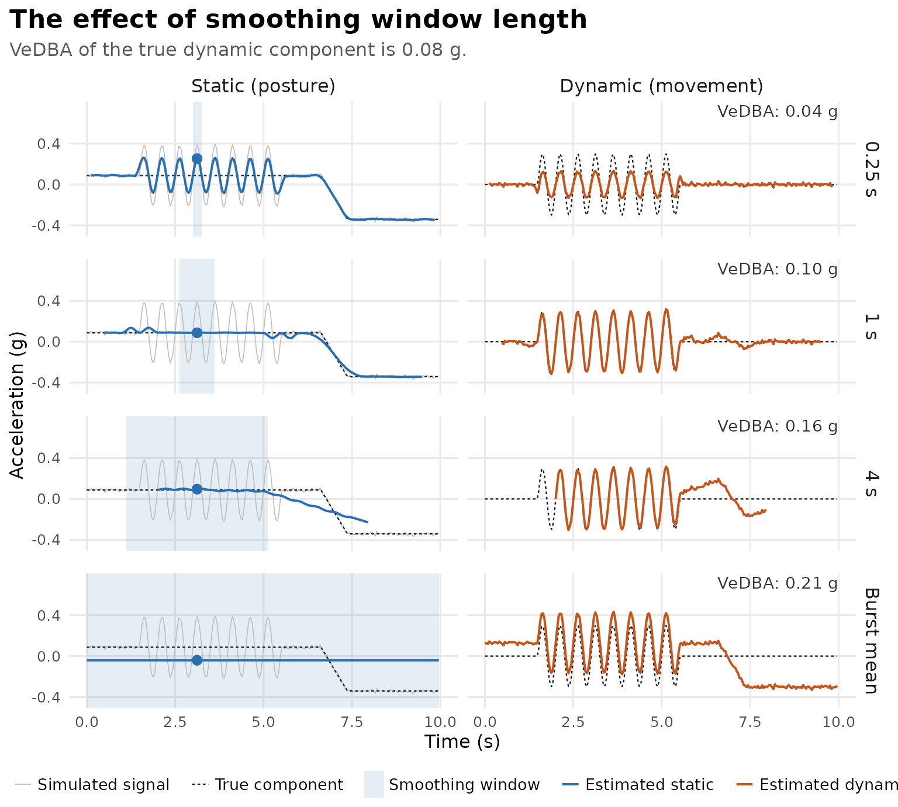
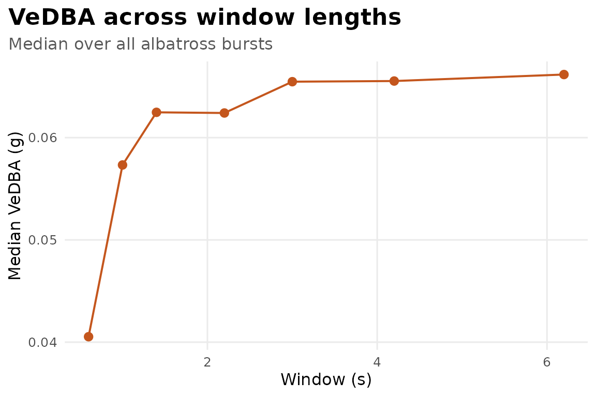
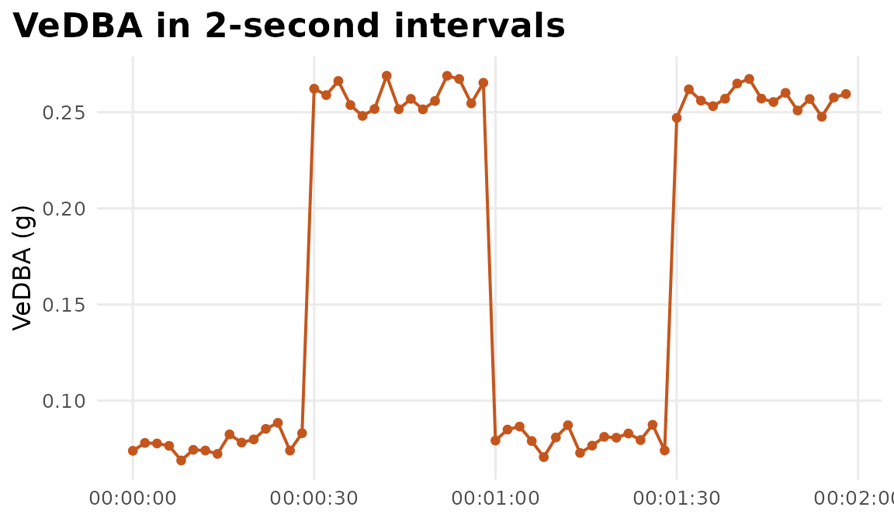
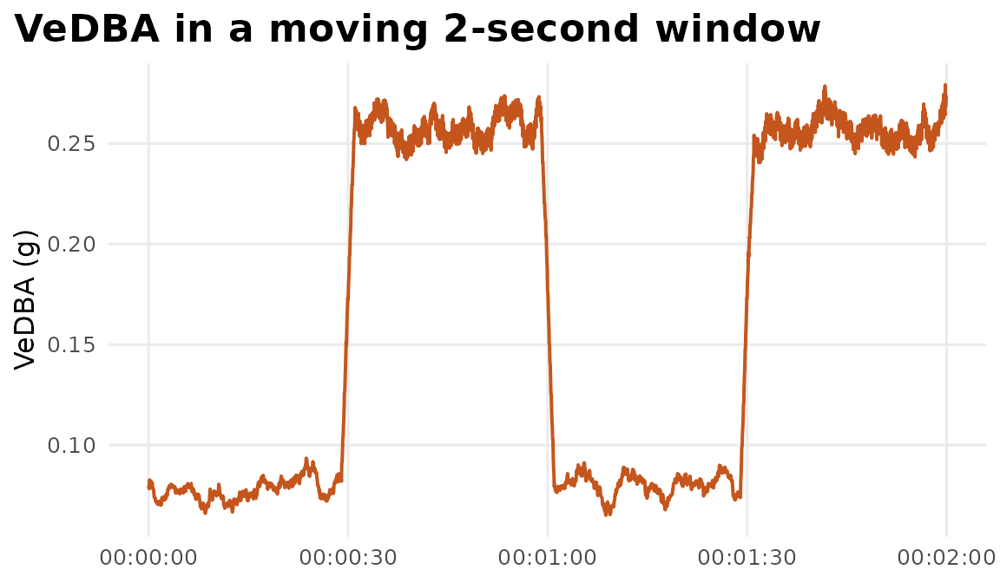

# Measuring activity from acceleration data

After extracting IMU data into a vector of bursts (see [Loading IMU
data](https://move2universe.github.io/move2imu/articles/move2imu.html#loading-imu-data)),
we will typically want to summarize the individual burst samples into a
more interpretable measure of activity. This vignette shows how to
extract simple activity metrics from `acc` bursts and reattach these
metrics to corresponding location data collected with GPS.

``` r

library(move2imu)
library(move2)
library(dplyr)
library(ggplot2)
```

First, we’ll load the albatross example data and extract the
acceleration bursts:

``` r

alb <- albatrosses()
alb$acceleration <- as_acc(alb)
```

These data contain 12-second bursts recorded at 5 Hz across two axes.

``` r

alb$acceleration
#> <acceleration[54]>
#>  [1] <NA>              (1824.17 1913.83) (1904.3 1926.5)   (1823.27 1913.42)
#>  [5] (1826.7 1915.7)   (1719.07 1908.8)  <NA>              (1943.47 2028.05)
#>  [9] (1927.98 2013.72) (1926.7 2008.82)  (1940.97 2023.93) (1940.02 2021.87)
#> [13] (1969.07 2044.2)  <NA>              (1962.88 2033.35) (2062.08 2023.48)
#> [17] (2090.73 2025.83) (2083.92 2051.48) (1887.58 1927.13) <NA>             
#> [21] (1846.38 1948.13) (1881.15 1938.03) (1841.58 2093.23) (1778.92 2129.55)
#> [25] (1812.17 1952.13) <NA>              (1790.4 1927.4)   (1811.85 1923.43)
#> [29] (1804.47 1935.05) (1811.45 1937.57) (2012.53 2227.17) <NA>             
#> [33] (1970.52 2238.62) (2130.75 2082.43) (1997.18 2074.33) (2049.4 2060.38) 
#> [37] (1975.93 1868.22) <NA>              (1920.02 2128.58) (1879.35 1920.62)
#> [41] (1927.5 1941.72)  (1949.27 1962.57) (1936.87 1918.93) <NA>             
#> [45] (1672.52 1865.77) (1942.15 1922.33) (2072.85 1952.1)  (1617.97 1944.63)
#> [49] (1845.87 1921.13) <NA>              (1838.77 1929.6)  (1843.57 1929.52)
#> [53] (1852.25 1929.65) (1829.97 1932.28)
#> # frequency: 5 [Hz]
```

## Computing dynamic body acceleration

Dynamic body acceleration is a commonly used measure of animal activity
and is composed of two acceleration components:

- A *static* component, which stems from gravity or other sources of
  constant acceleration (and therefore reflects the animal’s posture).
- A *dynamic* component, which stems from the animal’s own movements.

The dynamic component is a proxy for activity and, in many species, for
energy expenditure (Wilson et al., 2020). To estimate it, we must
isolate and remove the static acceleration to the best of our ability.
We’ll demonstrate how to compute vectorial dynamic body acceleration
(VeDBA) on our albatross data.

First, we calibrate our data to units of *g* to make our DBA results
more interpretable (see the [calibration
vignette](https://move2universe.github.io/move2imu/articles/calibration.md)
for details). For this purpose, we suppose that all the birds in the
study carried first-generation e-obs tags set to low sensitivity.

``` r

alb$acceleration <- transform_imu(
  alb$acceleration,
  acc_calibration(
    "eobs",
    tag_id = 1000,
    sensitivity = "low",
    units = "standard_free_fall"
  )
)
```

### Choosing a smoothing window

To separate the two acceleration components for a burst of data, we
compute a running mean over all the samples within a given window of
time. This helps to separate cyclical patterns (e.g. wingbeats) from
stable acceleration signals.

In general, the window length should span several cycles of the primary
movement of interest, but remain short enough to avoid misclassifying
changes in posture as movements.

The figure below shows how the window length affects the decomposition
of static and dynamic acceleration. We’ve generated some example 25 Hz
data showing an acceleration pattern for a hypothetical bird, and
plotted the values from one of its axes. The bird shows a cyclical
flapping pattern, glides, and then adjusts its posture (e.g. to start a
descent), producing an overall change in the share of gravity on this
axis. In this case the wingbeats are the dynamic movement of interest
that we want to estimate, meaning a good decomposition is one that
isolates the cyclical pattern from the posture change.

On the left, the blue line shows the static acceleration estimated for
the given window size (shown as a shaded blue rectangle centered on the
marked point). In the first row, where the window is shorter than one
wingbeat, the running mean reproduces much of the oscillation, thus
incorporating it into the static component. This means we underestimate
the portion of the signal that comes from dynamic sources.



As the window size increases in the second row, we average several
oscillations together, canceling them out. This leaves most of the
oscillatory behavior correctly in the dynamic component, producing a
good estimate of the dynamic acceleration.

As the window keeps getting longer, though, we start to average the
postural change with samples where no postural change exists, and end up
treating some of the static acceleration as movement.

Finally, when we use the mean of the burst as the static estimate, we
classify the entire postural change as dynamic, producing an
overestimate of the dynamic acceleration in this case.

The estimates we use for activity metrics, like VeDBA, thus depend on an
appropriate selection of the decomposition window, which depends both on
the behavior(s) of interest as well as the sampling methodology.

For species whose stroke cycles are shorter than 3 seconds, Shepard et
al. (2008) suggest at least a 3-second window. Albatrosses mostly soar
rather than flap, but the repeating movements that do appear in these
data (likely including occasional wingbeats) last about a second or
less, so we will adopt this guidance here.

To compute VeDBA, we simply use the
[`vedba()`](https://move2universe.github.io/move2imu/reference/dba.md)
function with the chosen window.

``` r

alb$vedba <- vedba(
  alb$acceleration,
  smoothing_window = units::set_units(3, "s")
)

alb$vedba
#> Units: [standard_free_fall]
#>  [1]          NA 0.068884904 0.072239477 0.064800946 0.058539038 0.072790297
#>  [7]          NA 0.073737447 0.132444286 0.102806719 0.068233055 0.060682279
#> [13] 0.236549955          NA 0.236350722 0.114085328 0.089494390 0.090803532
#> [19] 0.175975707          NA 0.083250335 0.222811565 0.040281270 0.138025808
#> [25] 0.053777846          NA 0.072020377 0.078039083 0.045069801 0.059042416
#> [31] 0.342381587          NA 0.034573195 0.011673462 0.009311533 0.010207175
#> [37] 0.011146326          NA 0.010442567 0.010344942 0.011322390 0.012764422
#> [43] 0.010587842          NA 0.033883944 0.012618563 0.010646915 0.018909796
#> [49] 0.210175793          NA 0.065469180 0.068091649 0.063682861 0.068620226
```

Shepard et al. (2008) also suggest identifying an appropriate window by
computing VeDBA at multiple window lengths and finding the point at
which the curve flattens:

``` r

alb_acc <- alb$acceleration[!is.na(alb$acceleration)]

# Windows of 3 to 31 samples at 5 Hz
windows <- c(3, 5, 7, 11, 15, 21, 31) / 5

# Median VeDBA at each window size
v <- purrr::map_dbl(
  windows,
  function(w) median(as.numeric(vedba(alb_acc, smoothing_window = w)))
)

d <- data.frame(window = windows, vedba = v)

ggplot(d, aes(x = window, y = vedba)) +
  geom_line(colour = "#c4561d", linewidth = 0.7) +
  geom_point(colour = "#c4561d", size = 2.5) +
  labs(
    x = "Window (s)",
    y = "Median VeDBA (g)",
    title = "VeDBA across window lengths",
    subtitle = "Median over all albatross bursts"
  )
```



VeDBA rises steeply for windows up to about 1.5 seconds and changes
little beyond about 3 seconds, which supports choosing a 3-second
window.

### Caveats

Some data are collected in shorter bursts that may not fit a meaningful
window. In these cases, you can pass `smoothing_window = "burst"`, which
estimates the static component as the mean of each whole burst. For very
short bursts (a few seconds or less), which are unlikely to contain
major posture changes, the mean can produce a reasonable estimate of
static acceleration.

Furthermore, VeDBA is sensitive not only to the window length but also
to other features of the data, like sampling rate and number of axes.

These data were sampled at 5 Hz, which is quite slow relative to most
flapping frequencies. This limits the resolution with which we can
identify flapping flight, leading to underestimated VeDBA. Additionally,
these data were recorded on only 2 axes, while DBA metrics are often
calculated on data with 3. These VeDBA values thus shouldn’t be compared
to measurements computed on 3-axis data.

The code here is intended to serve as a demonstration of a workflow for
computing these metrics rather than as a comprehensive analysis.

## Linking to locations

Often, the recording times of acceleration and GPS data don’t match
exactly. In the albatross data, for instance, some GPS fixes are
recorded up to a second after the start of an acceleration burst.
However, we may be interested in associating acceleration metrics with
nearby GPS locations.

To do so, we’ll separate the VeDBA values calculated above from the GPS
fixes by removing rows with missing VeDBA values:

``` r

alb_v <- alb |>
  filter(!is.na(vedba)) |>
  sf::st_drop_geometry() |>
  as_tibble() |>
  select(individual_local_identifier, timestamp, vedba) |>
  rename(vedba_time = timestamp)

head(alb_v)
#> # A tibble: 6 × 3
#>   individual_local_identifier vedba_time                         vedba
#>   <fct>                       <dttm>              [standard_free_fall]
#> 1 4266-84831108               2008-07-27 00:00:56               0.0689
#> 2 4266-84831108               2008-07-27 00:15:00               0.0722
#> 3 4266-84831108               2008-07-27 00:30:00               0.0648
#> 4 4266-84831108               2008-07-27 00:45:00               0.0585
#> 5 4266-84831108               2008-07-27 01:00:00               0.0728
#> 6 4261-2228                   2008-07-27 00:00:15               0.0737
```

Then, we’ll isolate the GPS location rows by removing rows with empty
geometries and dropping the acceleration-based columns:

``` r

alb_gps <- alb |>
  filter(!sf::st_is_empty(alb)) |>
  select(-acceleration, -vedba)
```

We can then join our VeDBA values to our GPS fix locations by each
animal’s ID and recording timestamp. However, if we require timestamps
to match exactly, only 2 of the 9 fixes would have a match:

``` r

left_join(
  alb_gps,
  alb_v,
  by = join_by(individual_local_identifier, timestamp == vedba_time)
) |>
  pull(vedba)
#> Units: [standard_free_fall]
#> [1] 0.06888490 0.07373745         NA         NA         NA         NA         NA
#> [8]         NA         NA
```

Instead, we can use a *rolling join* to match all records by a provided
inequality. Here, `closest(timestamp >= vedba_time)` links records by
matching each GPS fix timestamp to the most recent VeDBA record that
started at or before it, within the same individual:

``` r

alb_joined <- left_join(
  alb_gps,
  alb_v,
  by = join_by(individual_local_identifier, closest(timestamp >= vedba_time))
)
```

A rolling join always takes the closest match, no matter how far away in
time it is. Before using the result, you may want to discard matches
where the records are far from each other in time. For instance, here we
compute the time difference for each match and keep only cases where the
difference is at most 2 seconds:

``` r

alb_joined <- alb_joined |>
  mutate(
    gap = as.numeric(timestamp - vedba_time, units = "secs"),
    vedba = if_else(gap <= 2, vedba, NA)
  )

alb_joined |>
  as_tibble() |>
  select(individual_local_identifier, timestamp, vedba_time, gap, vedba)
#> # A tibble: 9 × 5
#>   individual_local_ide…¹ timestamp           vedba_time               gap  vedba
#>   <fct>                  <dttm>              <dttm>                 <dbl> [stan…
#> 1 4266-84831108          2008-07-27 00:00:56 2008-07-27 00:00:56 0        0.0689
#> 2 4261-2228              2008-07-27 00:00:15 2008-07-27 00:00:15 0        0.0737
#> 3 2131-2131              2008-07-27 00:00:55 2008-07-27 00:00:55 0.999    0.237 
#> 4 1163-1163              2008-07-27 00:00:50 2008-07-27 00:00:50 0.998    0.176 
#> 5 3275-30662             2008-07-27 00:00:43 2008-07-27 00:00:43 0.998    0.0538
#> 6 unbanded-153           2008-07-27 00:00:55 2008-07-27 00:00:55 0.999    0.342 
#> 7 unbanded-154           2008-07-27 00:00:56 2008-07-27 00:00:56 0.001000 0.0111
#> 8 unbanded-156           2008-07-27 00:00:17 2008-07-27 00:00:17 0.001000 0.0106
#> 9 unbanded-159           2008-07-27 00:00:14 2008-07-27 00:00:14 0.999    0.210 
#> # ℹ abbreviated name: ¹​individual_local_identifier
```

Here every fix is within a second of its burst, so all matches are kept.
The check matters more when records are sparse.

### Interpolating locations

These albatross data contain only one GPS fix per individual but five
acceleration bursts, so by joining to our GPS locations we end up
discarding some of the collected acceleration data. If we instead want
to associate a location with each *burst*, an alternative is to
interpolate locations to the burst times with
[`move2::mt_interpolate()`](https://bartk.gitlab.io/move2/reference/mt_interpolate.html).

## Continuous data

Some tags record acceleration continuously, producing very long “bursts”
in the resulting `acc` vector. In these cases,
[`vedba()`](https://move2universe.github.io/move2imu/reference/dba.md)
would return a single value for potentially hours of data, which tells
us little about how activity changes across the recording period.

To demonstrate, we’ll simulate two minutes of continuous 20 Hz data that
alternates between 30-second periods of rest and movement (in this case,
a 4 Hz oscillation on the Z axis):

``` r

set.seed(1)
secs <- seq(0, 120 - 1 / 20, by = 1 / 20)

# A 4 Hz oscillation on the Z axis during every second 30 s period
moving <- (secs %/% 30) %% 2 == 1
movement <- ifelse(moving, 0.4 * sin(2 * pi * 4 * secs), 0)

acc_cont <- acc(
  list(cbind(
    X = rnorm(length(secs), sd = 0.05),
    Y = rnorm(length(secs), sd = 0.05),
    Z = 1 + movement + rnorm(length(secs), sd = 0.05)
  )),
  frequency = units::set_units(20, "Hz"),
  start = as.POSIXct("2024-01-01", tz = "UTC")
)

# The simulated values are in units of g
acc_cont <- set_imu_units(acc_cont, "standard_free_fall")
```

The whole recording is a single burst:

``` r

acc_cont
#> <acceleration[1]>
#> [1] (0 0 1) [standard_free_fall]
#> # frequency: 20 [Hz]
```

The trace below shows periods of increased movement on the Z axis, as
well as a 1 *g* offset due to gravity.

``` r

plot_imu_trace(acc_cont, ylab = "Acceleration (g)") |>
  dygraphs::dyOptions(labelsUTC = TRUE)
```

And as expected,
[`vedba()`](https://move2universe.github.io/move2imu/reference/dba.md)
gives a single value for the entire recording:

``` r

vedba(acc_cont, smoothing_window = 1)
#> 0.1684596 [standard_free_fall]
```

To produce more meaningful values, we can instead use
[`dynamic_acc()`](https://move2universe.github.io/move2imu/reference/static_acc.md)
to separate out the dynamic component of the signal without calculating
any DBA metrics. This returns an `acc` vector containing the dynamic
component estimated with the given `smoothing_window`:

``` r

dyn_acc <- dynamic_acc(acc_cont, smoothing_window = 1)

dyn_acc
#> <acceleration[1]>
#> [1] (0 0 0) [standard_free_fall]
#> # frequency: 20 [Hz]
```

As we can see, the 1 *g* offset from gravity on the Z axis has been
removed, but the periods of increased activity remain:

``` r

plot_imu_trace(dyn_acc, ylab = "Acceleration (g)") |>
  dygraphs::dyOptions(labelsUTC = TRUE)
```

Now that we have the dynamic component alone, we can split it into
intervals of a given length to calculate VeDBA at points throughout the
recording:

``` r

dyn_split <- split_imu(dyn_acc, units::set_units(2, "s"), flatten = TRUE)

head(dyn_split)
#> <acceleration[6]>
#> [1] (0 0 0) [standard_free_fall] (0 0 0) [standard_free_fall]
#> [3] (0 0 0) [standard_free_fall] (0 0 0) [standard_free_fall]
#> [5] (0 0 0) [standard_free_fall] (0 0 0) [standard_free_fall]
#> # frequency: 20 [Hz]
```

At this point, we can calculate VeDBA for each interval. However, we
can’t use
[`vedba()`](https://move2universe.github.io/move2imu/reference/dba.md)
here, because it would decompose the signal again, which we’ve already
done by calling
[`dynamic_acc()`](https://move2universe.github.io/move2imu/reference/static_acc.md).
Instead, we calculate VeDBA ourselves, as the mean of \sqrt{X^2 + Y^2 +
Z^2} across each interval’s samples:

``` r

# Apply the VeDBA formula to each interval. We set na.rm = TRUE because samples
# at the start and end of the recording have no static estimate, so their
# dynamic component is NA
v <- purrr::map_dbl(
  bursts(dyn_split),
  function(b) mean(sqrt(rowSums(b^2)), na.rm = TRUE)
)

cont_vedba <- data.frame(start = starts(dyn_split), vedba = v)

head(cont_vedba)
#>                 start      vedba
#> 1 2024-01-01 00:00:00 0.07395754
#> 2 2024-01-01 00:00:02 0.07803674
#> 3 2024-01-01 00:00:04 0.07774856
#> 4 2024-01-01 00:00:06 0.07652752
#> 5 2024-01-01 00:00:08 0.06892284
#> 6 2024-01-01 00:00:10 0.07445380
```

As we would expect, VeDBA is higher in the intervals where the simulated
data contains more movement:

``` r

ggplot(cont_vedba, aes(x = start, y = vedba)) +
  geom_line(colour = "#c4561d", linewidth = 0.7) +
  geom_point(colour = "#c4561d", size = 1.5) +
  labs(
    x = NULL,
    y = "VeDBA (g)",
    title = "VeDBA in 2-second intervals"
  )
```



### Decompose, then split

You might wonder why we don’t just split our signal *first* and then
calculate VeDBA, like so:

``` r

vedba(
  split_imu(acc_cont, units::set_units(2, "s"), flatten = TRUE),
  smoothing_window = 1
)
#> Units: [standard_free_fall]
#>  [1] 0.07988503 0.08705774 0.08091989 0.08064738 0.06607695 0.06978445
#>  [7] 0.07065019 0.07426794 0.08431618 0.08083381 0.07976160 0.08408773
#> [13] 0.08160594 0.07304498 0.08321724 0.27164165 0.25843009 0.27465942
#> [19] 0.24862272 0.24391342 0.25295721 0.25896534 0.25014100 0.25609013
#> [25] 0.26180832 0.25403929 0.28416228 0.27278760 0.24003217 0.26899356
#> [31] 0.07575546 0.08108136 0.09436291 0.07530184 0.06105895 0.08599502
#> [37] 0.07583215 0.07473612 0.07067513 0.07861323 0.07478112 0.07174302
#> [43] 0.08179168 0.08750090 0.07001597 0.25329474 0.26167360 0.27068261
#> [49] 0.26199191 0.25572995 0.27570709 0.27158119 0.26286657 0.25585550
#> [55] 0.25496490 0.24539168 0.23944764 0.22962810 0.25402144 0.26242684
```

The reason is that this approach discards useful data. When we apply the
smoothing window, we can’t use samples near the beginning and end of a
burst, because we need data for the full window to be present.
Decomposing after splitting therefore discards the starting and ending
samples of **each interval**.

The result is that splitting first requires that each interval be longer
than the smoothing window, limiting the resolution at which we can
compute metrics like VeDBA. Furthermore, when fewer values are available
in each interval, these metrics become noisier and potentially less
accurate. In contrast, decomposing the signal first only discards
samples from the beginning and end of the entire recording, making much
better use of the recorded data. In this example, splitting first
discards 1,200 samples, while decomposing first discards only 20.

### Applying a window function across continuous data

[`split_imu()`](https://move2universe.github.io/move2imu/reference/split_imu.md)
splits the signal into non-overlapping intervals. In some cases, you may
instead want to apply a function within a sequence of overlapping
windows that move along the signal.

Several R packages, such as [slider](https://slider.r-lib.org/) and
[zoo](https://CRAN.R-project.org/package=zoo), provide moving window
functions, which can be used with the decomposed acceleration signal to
calculate these kinds of metrics.

For instance, with the slider package we can calculate VeDBA in a
2-second window centered on each sample of the dynamic component.

``` r

# Convert to a data frame of samples.
# slider needs plain numbers, so we drop the units first.
dyn_samples <- imu_samples(drop_imu_units(dyn_acc))

# Calculate VeDBA in a 2-second window centered on each sample
# `group_by()` is superfluous here, but avoids computing across burst boundaries
dyn_rolling <- dyn_samples |>
  group_by(burst) |>
  mutate(
    norm = sqrt(X^2 + Y^2 + Z^2),
    vedba = slider::slide_index_dbl(
      norm,
      time,
      ~ mean(.x, na.rm = TRUE),
      .before = 1,
      .after = 1
    )
  ) |>
  ungroup()

ggplot(dyn_rolling, aes(x = time, y = vedba)) +
  geom_line(colour = "#c4561d", linewidth = 0.7) +
  labs(x = NULL, y = "VeDBA (g)", title = "VeDBA in a moving 2-second window")
```



Here we use
[`imu_samples()`](https://move2universe.github.io/move2imu/reference/imu_samples.md)
to convert our `acc` vector to a single data frame, which provides
sample timestamps. This allows us to easily define the window length in
seconds, rather than as a number of samples.

A similar approach can be used to apply other custom functions across a
stream of continuous samples, or can even be used with
[`static_acc()`](https://move2universe.github.io/move2imu/reference/static_acc.md)
for analyses focused on animal posture instead of motion.

## References

Shepard, E. L. C., Wilson, R. P., Halsey, L. G., Quintana, F., Gómez
Laich, A., Gleiss, A. C., Liebsch, N., Myers, A. E., & Norman, B.
(2008). Derivation of body motion via appropriate smoothing of
acceleration data. *Aquatic Biology*, 4, 235–241.
<https://doi.org/10.3354/ab00104>

Wilson, R. P., Börger, L., Holton, M. D., Scantlebury, D. M.,
Gómez-Laich, A., Quintana, F., et al. (2020). Estimates for energy
expenditure in free-living animals using acceleration proxies: A
reappraisal. *Journal of Animal Ecology*, 89, 161–172.
<https://doi.org/10.1111/1365-2656.13040>
